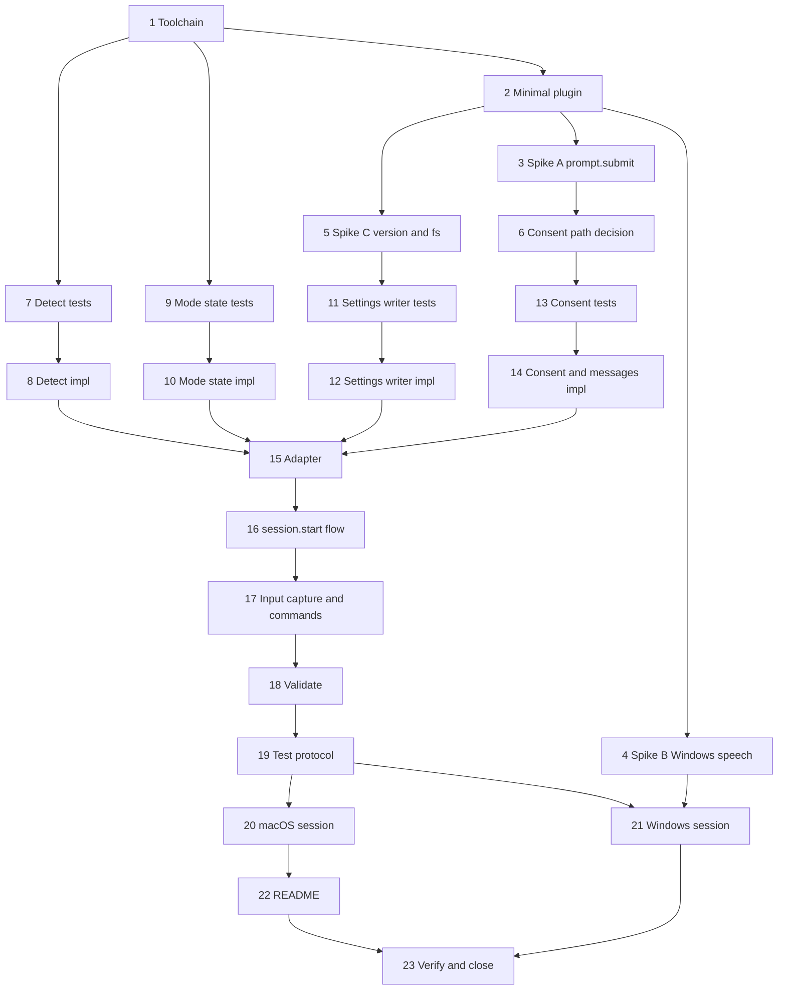

# Plan: Screen Reader Detection and Mode Enabling

**Spec:** specs/screen-reader-detection.md (v0.1.0)
**Created:** 2026-10-09
**Team:** solo
**Estimated Effort:** 26 h of focused work plus two manual test sessions (macOS, Windows); about two weeks part-time, matching the M1 appetite
**Status:** In Progress (tasks 1 to 19 and 22 done on 2026-10-09; 4, 20, 21 and 23 need the manual sessions)

## 1. Overview

First code in the repository. The plan bootstraps the plugin (manifest, hooks, TypeScript toolchain), answers the three open questions from the spec with throwaway spikes before any design is fixed, then builds the feature as pure, Vitest-testable modules behind a thin adapter over the Claude Code mod API. The adapter is the only code that touches `$.process`, `$.fs`, `$.store`, `$.audio` and `$.ui`, so everything that decides what to do can be tested without Claude Code running. Manual sessions with VoiceOver and NVDA close the plan.

## 2. Task Breakdown

Estimates include a 20% contingency for an API that has no tests of its own yet.

### Phase 0: Bootstrap and spikes (7 h)

| # | Task | Spec Ref | Files | Type | Estimate |
|---|------|----------|-------|------|----------|
| 1 | Bootstrap toolchain: `package.json` (scripts `test`, `lint`, `typecheck`), `tsconfig.json` strict ESM, ESLint flat config, Vitest config, `.editorconfig` | AC-015 | package.json, tsconfig.json, eslint.config.js, vitest.config.ts | infra | 1.5 h |
| 2 | Minimal plugin: `.claude-plugin/plugin.json` (name, version, description, commands), `hooks/hooks.json` pointing at `src/mod.ts`, `register()` that only logs. `claude plugin validate .` passes and `claude --plugin-dir .` loads it | AC-015 | .claude-plugin/plugin.json, hooks/hooks.json, src/mod.ts | impl | 1.5 h |
| 3 | Spike A: can a `prompt.submit` handler consume the submission? Throwaway handler that swallows the text `y`; observe whether the model receives it. Record result in `docs/research/spikes-2026-10.md` | AC-005, AC-008, Dep. 1 | docs/research/spikes-2026-10.md | spike | 1.5 h |
| 4 | Spike B: `$.audio.speak` on Windows: audible? through NVDA or the system voice? Also `$.ui.notify`. Same note | TC-002, Dep. 2 | docs/research/spikes-2026-10.md | spike | 1 h + Windows machine |
| 5 | Spike C: how the mod learns its own version and plugin root (`options` passed to `register`, `$.fs` relative read of the manifest, or API field). Also confirm `$.fs` can rename or only write | AC-007, AC-014, AC-006, Dep. 3 | docs/research/spikes-2026-10.md | spike | 1 h |
| 6 | Decide the consent path from Spike A: keep `y`/`n` capture, or fall back to commands only and amend AC-005 wording in the spec | AC-005 | specs/screen-reader-detection.md | decision | 0.5 h |

### Phase 1: Pure modules, test-first (10 h)

| # | Task | Spec Ref | Files | Type | Estimate |
|---|------|----------|-------|------|----------|
| 7 | Tests for detection parsers: `pgrep` output with and without a PID, PowerShell output with `nvda`, `jfw`, both, none, garbage, SPI flag fallback, timeout | AC-001, edge cases | tests/unit/detect.test.ts | test | 1.5 h |
| 8 | Implement `src/detect/`: `detectDarwin`, `detectWindows` as functions of a `run(cmd) => Promise<{stdout, code}>` injected dependency, 2 s budget, `DetectionResult` | AC-001 | src/detect/index.ts, darwin.ts, windows.ts, types.ts | impl | 1.5 h |
| 9 | Tests for mode state: env `1`, env `0`, env empty string, user settings true/false/missing, project settings true, precedence | AC-002, AC-003, AC-004, edge cases | tests/unit/mode-state.test.ts | test | 1 h |
| 10 | Implement `src/mode-state.ts`: `resolveModeState(env, userSettings, projectSettings) => ModeState`, plus `shouldAsk(modeState, consent, detection, modVersion)` | AC-002, AC-003, AC-004, AC-007, AC-014 | src/mode-state.ts, src/consent.ts | impl | 1 h |
| 11 | Tests for settings writer: writes key preserving others and indentation, creates missing file and directory, refuses invalid JSON byte-for-byte, removes key, reports "not set", HOME/USERPROFILE missing | AC-006, AC-010, AC-013, edge cases | tests/unit/settings-writer.test.ts | test | 1.5 h |
| 12 | Implement `src/settings-writer.ts` over an injected `fs` interface (`read`, `write`, `exists`, `mkdir`, optional `rename`): `enable()`, `disable()`, `readAxSetting()`; atomic strategy chosen per Spike C | AC-006, AC-010, AC-013 | src/settings-writer.ts, src/paths.ts | impl | 1.5 h |
| 13 | Tests for consent flow state machine: idle, pending, answered yes/no, timed out, cancelled by command, ordinary prompt passthrough when idle | AC-005, AC-007, AC-008, AC-009, edge cases | tests/unit/consent.test.ts | test | 1 h |
| 14 | Implement `src/consent.ts` state machine and `src/messages.ts` (every spoken line and its transcript twin, reader names) | AC-005, AC-007, AC-008, AC-012 | src/consent.ts, src/messages.ts | impl | 1 h |

### Phase 2: Mod wiring (5 h)

| # | Task | Spec Ref | Files | Type | Estimate |
|---|------|----------|-------|------|----------|
| 15 | Adapter `src/adapter.ts`: wraps `$.process.run`, `$.fs`, `$.env.get`, `$.store`, `$.audio.speak`, `$.ui.notify` and transcript output behind the interfaces the pure modules take; `say(line)` always speaks and prints | AC-012 | src/adapter.ts | impl | 1.5 h |
| 16 | `session.start` flow in `src/mod.ts`: detection, mode state, consent decision, question with 30 s timer, bell | AC-001 to AC-008 | src/mod.ts, src/flow.ts | impl | 1.5 h |
| 17 | `prompt.submit` capture while pending (or command-only path per task 6) and `command.run` handlers for `/a11y:on`, `/a11y:off`, `/a11y:status`; commands declared in the manifest | AC-009, AC-010, AC-011 | src/mod.ts, src/commands.ts, .claude-plugin/plugin.json | impl | 1.5 h |
| 18 | `claude plugin validate .` and compare its event and API listing with AC-015; fix drift | AC-015 | hooks/hooks.json, src/mod.ts | verify | 0.5 h |

### Phase 3: Manual verification and docs (4 h + sessions)

| # | Task | Spec Ref | Files | Type | Estimate |
|---|------|----------|-------|------|----------|
| 19 | Manual test protocol: TC-001 to TC-008 as a checklist with capture file names and an audio column | TC-001..008 | docs/testing/screen-reader-detection.md | docs | 1 h |
| 20 | macOS session with VoiceOver: TC-001, TC-003 to TC-008; save transcript captures | TC-* | tests/screenshots/screen-reader-detection/*.txt | manual | 1.5 h |
| 21 | Windows session with NVDA: TC-002, TC-003, TC-005, TC-006; save captures; log how speech is heard | TC-002, TC-* | tests/screenshots/screen-reader-detection/*.txt | manual | 1.5 h |
| 22 | README: shell installation, restart step, the three commands, what the mod writes and how to undo it | AC-016 | README.md | docs | 0.5 h |
| 23 | `/add:verify`, update CHANGELOG, mark spec Implementing → Complete, fill the "Maps to" fields in the spec | all | specs/screen-reader-detection.md, CHANGELOG.md | verify | 0.5 h |

## 3. Execution Order

Critical path: 1 → 2 → 3 → 6 → 13 → 14 → 15 → 16 → 17 → 18 → 19 → 20 → 22 → 23.

## 4. TDD Strategy

### RED Phase (Tests First)
- Tasks 7, 9, 11, 13 write Vitest suites against interfaces, before implementation. Fixtures are literal strings (`pgrep` and PowerShell output, settings files) under `tests/unit/fixtures/`.
- Everything that touches the mod API is injected (`run`, `fs`, `env`, `store`, `clock`), so tests never need Claude Code.
- Expected transcript lines are asserted verbatim; they are the product.

### GREEN Phase (Implementation)
- Tasks 8, 10, 12, 14: smallest code that passes. No speculative platform support (no Linux code paths).
- Task 12 uses write-to-temp-then-rename only if Spike C shows `$.fs` can rename; otherwise write, read back, compare, and report on mismatch.

### REFACTOR Phase
- After task 17: collapse duplicate message strings into `messages.ts`, make the `session.start` flow a single pure `decide(inputs) => actions` function executed by the adapter, so the flow itself gains a unit test.
- Keep `mod.ts` under 80 lines: registration only.

## 5. File Changes

### New Files
- `package.json`, `tsconfig.json`, `eslint.config.js`, `vitest.config.ts`: toolchain
- `.claude-plugin/plugin.json`: manifest with the three commands and the mod version
- `hooks/hooks.json`: mod entry
- `src/mod.ts`: `register(on, options)`, handler registration only
- `src/flow.ts`: `session.start` decision and action sequence
- `src/adapter.ts`: mod API wrappers, `say()` that speaks and prints
- `src/detect/{index,darwin,windows,types}.ts`: detection
- `src/mode-state.ts`, `src/consent.ts`, `src/messages.ts`, `src/settings-writer.ts`, `src/paths.ts`, `src/commands.ts`
- `tests/unit/{detect,mode-state,settings-writer,consent,flow}.test.ts` and `tests/unit/fixtures/`
- `docs/research/spikes-2026-10.md`: spike results
- `docs/testing/screen-reader-detection.md`: manual protocol
- `tests/screenshots/screen-reader-detection/*.txt`: captures

### Modified Files
- `README.md`: installation, commands, what is written where
- `CLAUDE.md`: replace "package.json does not exist yet" with the real commands; confirm the layout
- `specs/screen-reader-detection.md`: AC-005 wording if Spike A fails; "Maps to" fields; status
- `CHANGELOG.md`: Unreleased entry
- `.gitignore`: nothing expected

## 6. Dependencies

### Must Complete First
- Task 2 before any spike: the spikes run inside a loaded plugin.
- Spike A (task 3) before the consent state machine (13, 14) and input capture (17).
- Spike C (task 5) before the settings writer (11, 12) and version comparison (10).
- A Windows 11 machine or VM with NVDA and Claude Code >= 2.1.287 before tasks 4 and 21. If it is not available in the first week, tasks 4 and 21 move after task 23 and TC-002 stays open in the spec.

### Can Parallelize
- Solo project, so sequential execution. Independent chains that can be reordered freely: detection (7, 8), mode state (9, 10), settings writer (11, 12). Spike B (4) can run on any day the Windows machine is at hand.

## 7. Risks and Mitigations

| Risk | Impact | Mitigation |
|------|--------|------------|
| `prompt.submit` cannot consume input, so `y`/`n` reaches the model | Medium: consent becomes command-only, wording changes | Spike A first (task 3); the state machine is written after the decision, not before |
| `$.audio.speak` silent on Windows | High for TC-002, none for the logic | Spike B early; if silent, the restart message still prints and `$.ui.notify` fires; Windows speech is milestone M3 anyway |
| `$.fs` offers no rename, atomic write impossible | Low: a crash mid-write could truncate settings | Write, read back, compare; keep a `.bak` copy before the first write of a session |
| Settings file in a format Claude Code accepts but strict JSON rejects (comments) | Medium: feature refuses to write for some users | AC-013 error path with manual fallback; log the reason; revisit if reports arrive |
| Mod loads after the first turn or `session.start` fires late, question interrupts the user's first prompt | Medium | Ask only if no prompt was submitted yet; otherwise defer the question to after the first `turn.complete` |
| The mod's question itself is unreadable in a graphical session | High: the whole point | Speech and bell carry the question; the transcript line is for sighted helpers and logs. Verified in task 20 with VoiceOver off and on |
| Claude Code release changes the mod API before M1 ends | Medium | Pin the tested version in the manifest description and CLAUDE.md; re-run `claude plugin validate .` after each upgrade |
| No Windows machine during the appetite | Medium | Tasks 4 and 21 deferred; the spec keeps TC-002 open; M1 success criteria are macOS-only by PRD |

## 8. Acceptance Verification

| AC ID | Criterion | Test(s) | Status |
|-------|-----------|---------|--------|
| AC-001 | Detect VoiceOver, NVDA, JAWS within 2 s | detect.test.ts; TC-001, TC-002 | Pending |
| AC-002 | Silent when mode already on | mode-state.test.ts; TC-003 | Pending |
| AC-003 | Env var set: never write; `0`: silent | mode-state.test.ts; TC-004 | Pending |
| AC-004 | Explicit `false` treated as refusal | mode-state.test.ts | Pending |
| AC-005 | Bell, spoken question, transcript twin | consent.test.ts, flow.test.ts; TC-001 | Pending |
| AC-006 | `y` writes key atomically, preserves file, restart message | settings-writer.test.ts; TC-001 | Pending |
| AC-007 | `n` stored with version, no re-ask | consent.test.ts; TC-005 | Pending |
| AC-008 | 30 s timeout, nothing stored | consent.test.ts; TC-008 | Pending |
| AC-009 | `/a11y:on` | settings-writer.test.ts; TC-006 | Pending |
| AC-010 | `/a11y:off` removes key, reports not set | settings-writer.test.ts; TC-006 | Pending |
| AC-011 | `/a11y:status` | flow.test.ts; TC-004, TC-005 | Pending |
| AC-012 | Every spoken line printed | adapter `say()` test; all TCs | Pending |
| AC-013 | Invalid JSON or write error: untouched file, fallback message | settings-writer.test.ts; TC-007 | Pending |
| AC-014 | New version re-asks once | consent.test.ts | Pending |
| AC-015 | `claude plugin validate .` lists only named events and APIs | task 18 | Pending |
| AC-016 | README shell installation | task 22, review | Pending |

## 9. Plan History

- 2026-10-09: Initial plan from /add:plan. Spikes gate the consent design; pure modules behind an adapter; macOS and Windows manual sessions.
- 2026-10-09: TDD cycle 1. Spikes A and C answered from the type declarations (docs/research/spikes-2026-10.md), so the consent design stayed as specified. Tests run in two harnesses: Vitest for hooks/lib and `claude plugin test` for the mod. Deviations: plugin named a11y-companion (reserved prefix), commands /earshot-on, /earshot-off, /earshot-status, helpers top-level because the loader only lets `$` reach top-level functions. Open: Spike B and the manual sessions (tasks 4, 20, 21), closing task 23.
