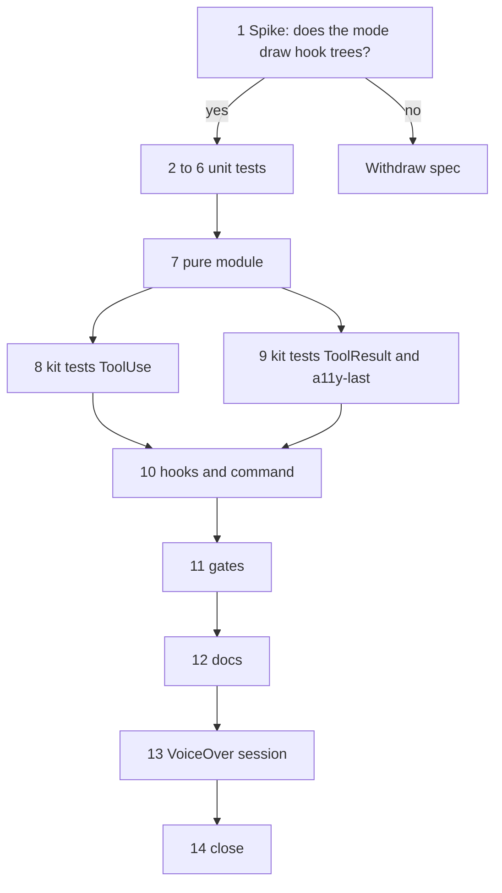

# Plan: Tool Narration

**Spec:** specs/tool-narration.md (v0.1.0)
**Created:** 2026-10-09
**Team:** solo
**Estimated Effort:** 9 h of focused work plus one manual VoiceOver session, after a 15-minute spike that decides whether the feature can be built at all
**Status:** In Progress (tasks 1 to 12 done on 2026-10-10; 13 and 14 need the VoiceOver session)

## 1. Overview

Two `ui.render` hooks on the `ToolUse` and `ToolResult` rows, drawn only when delivery is buffered, plus `/a11y-last`. Everything that decides what the rows say (the summary from the model's own `description` or the file name, the line count, the ring buffer of the last five results) is pure and lives in `hooks/lib/tool-narration.ts` under Vitest. The hooks themselves are thin: resolve the surface's `Text` element, return one line, or `next(e)`.

The spec hangs on one unknown: whether the terminal in screen reader mode, which prints flat labelled lines instead of Ink boxes, draws a render hook's tree for tool rows. Phase 0 answers it before any test is written. If the answer is no, the spec is withdrawn and the plan ends there.

## 2. Task Breakdown

Estimates include a 20% contingency.

### Phase 0: Spike, mandatory (0.5 h, needs the VoiceOver machine)

| # | Task | Spec Ref | Files | Type | Estimate |
|---|------|----------|-------|------|----------|
| 1 | Probe hook: temporarily add to `hooks/register.ts` a `ui.render` hook on `{ component: 'ToolUse' }` that returns `h(Text, null, 'tool: probe')` from `$.ui.resolve(e)`; start `claude --plugin-dir .` in screen reader mode, make Claude run one shell command, look for `tool: probe` in the transcript; then revert. Record the result in docs/research/spikes-2026-10.md | §8, §9 | hooks/register.ts (temporary), docs/research/spikes-2026-10.md | spike | 0.5 h |

Decision gate: `tool: probe` seen → continue. Not seen, and the debug log shows the tree was refused → fix the tree and retry once. Not seen with no refusal logged → the mode bypasses render hooks for tool rows; mark the spec Withdrawn with the evidence and stop.

### Phase 1: Pure module, test-first (3.5 h)

| # | Task | Spec Ref | Files | Type | Estimate |
|---|------|----------|-------|------|----------|
| 2 | Tests for `describeToolUse(tool, input)`: Bash with description, Bash without (60-char cut, newlines collapsed, ellipsis), Read/Write/Edit basenames, Grep/Glob patterns, Agent with and without description, WebFetch host, WebSearch query, MCP `mcp__server__name`, unknown tool, malformed input | AC-002, AC-003 | tests/unit/tool-narration.spec.ts | test | 0.75 h |
| 3 | Tests for `labelFor(flags)` and `summaryLine(flags, summary)`: running, errored, interrupted, done; single line, no control characters | AC-001, AC-009 | tests/unit/tool-narration.spec.ts | test | 0.25 h |
| 4 | Tests for `textOfResult(tool, output)` and `countLines`: Bash stdout+stderr, `content`, `text`, `file.content`, string output, object without text fields (JSON), empty, trailing newline not counted twice | AC-004, edge cases | tests/unit/tool-narration.spec.ts | test | 0.5 h |
| 5 | Tests for `createLastResults(5)`: newest first, replace on the same id, drop the sixth, `get(1)`, `get(n)` out of range, empty | AC-006, edge cases | tests/unit/tool-narration.spec.ts | test | 0.5 h |
| 6 | Tests for the `/a11y-last` reply lines (`Result of: 
`, nothing stored, out of range) | AC-006 | tests/unit/tool-narration.spec.ts | test | 0.25 h |
| 7 | Implement `hooks/lib/tool-narration.ts` and the message lines | AC-001 to AC-006, AC-009 | hooks/lib/tool-narration.ts, hooks/lib/messages.ts, hooks/lib/types.ts | impl | 1.25 h |

### Phase 2: Mod wiring, test-first (3 h)

| # | Task | Spec Ref | Files | Type | Estimate |
|---|------|----------|-------|------|----------|
| 8 | Kit tests with `$.ui.mount({ plugin: 'a11y-companion', surface: 'terminal', component: 'ToolUse', props })`: buffered delivery draws `tool: 
` (found by `ui.find({ type: 'Text', text: /^tool: / })`), errored and running labels, AskUserQuestion row left to the engine (`find` returns nothing of ours), live delivery left to the engine | AC-001 to AC-003, AC-005, AC-007 | hooks/narration.test.ts | test | 1 h |
| 9 | Kit tests for `ToolResult`: `result: N lines`, `error: N lines`, and that `/a11y-last` afterwards returns the full text with the `Result of:` line; out of range reply | AC-004, AC-006 | hooks/narration.test.ts | test | 0.75 h |
| 10 | Implement the two render hooks in `hooks/register.ts` with `h(Text, null, line)` (no JSX, so the file stays `.ts` and the loader's top-level rule is untouched); the `ToolResult` hook also stores the result; register `a11y-last` with argument hint `[n]` and its `command.run` handler | AC-001 to AC-008, AC-010 | hooks/register.ts | impl | 1.25 h |

### Phase 3: Verification and docs (2 h + session)

| # | Task | Spec Ref | Files | Type | Estimate |
|---|------|----------|-------|------|----------|
| 11 | `npm test`, `claude plugin test .`, `tsc`, `eslint`, `claude plugin validate .`; confirm the two `ui.render` matchers and `$.ui.resolve` in the listing | AC-010 | | verify | 0.5 h |
| 12 | README, CHANGELOG, CLAUDE.md layout; manual protocol docs/testing/tool-narration.md | AC-011 | README.md, CHANGELOG.md, CLAUDE.md, docs/testing/tool-narration.md | docs | 0.5 h |
| 13 | VoiceOver session: TC-001 to TC-005, captures | TC-* | tests/screenshots/tool-narration/ | manual | 1 h |
| 14 | Fill "Maps to", set the spec status, `/add:verify` | all | specs/tool-narration.md | verify | 0.5 h |

## 3. Execution Order

Critical path: 1 → 2..6 → 7 → 8 → 10 → 11 → 12 → 13 → 14.

## 4. TDD Strategy

### RED Phase (Tests First)
- Vitest (tasks 2 to 6) against plain inputs: tool names, input objects shaped like the built-in tools' declarations, output objects shaped like their results.
- Kit tests (tasks 8 and 9) mount the two components on the terminal surface through the plugin and read the tree by text, which is exactly what a screen reader would get.

### GREEN Phase (Implementation)
- Task 7, then 10. The render hooks contain no logic beyond `resolve`, one function call and `h(Text, null, line)`.
- The `ToolResult` hook stores `{ id: e.requestId, summary, text }` in the session's ring buffer; `/a11y-last` reads it.

### REFACTOR Phase
- `hooks/register.ts` will pass 300 lines with this feature: move the command handlers (`a11y-on`, `a11y-off`, `a11y-status`, `a11y-stream`, `a11y-last`) into `hooks/commands.ts` as top-level functions taking `$`, and keep `register.ts` to registration and the hooks. Verify with `claude plugin validate .` that the loader accepts `$` crossing into an imported module's top-level functions; if it refuses, keep everything in `register.ts` and accept the length.

## 5. File Changes

### New Files
- `hooks/lib/tool-narration.ts`: summaries, labels, result text and line counts, the ring buffer
- `tests/unit/tool-narration.spec.ts`
- `hooks/narration.test.ts`: kit tests mounting `ToolUse` and `ToolResult`
- `docs/testing/tool-narration.md`
- `tests/screenshots/tool-narration/*.txt`

### Modified Files
- `hooks/register.ts`: two `ui.render` hooks, `a11y-last`, ring buffer in session facts (possibly `hooks/commands.ts` after the refactor)
- `hooks/lib/messages.ts`, `hooks/lib/types.ts`
- `docs/research/spikes-2026-10.md`: spike result
- `README.md`, `CHANGELOG.md`, `CLAUDE.md`, `specs/tool-narration.md`

## 6. Dependencies

### Must Complete First
- Task 1 before everything: the VoiceOver machine and ten minutes.
- Whole answer delivery is merged (it is): `resolveDelivery` and `session.facts.delivery` are reused as they are.

### Can Parallelize
- Solo, sequential. Tasks 2 to 6 in any order; 8 and 9 in any order.

## 7. Risks and Mitigations

| Risk | Impact | Mitigation |
|------|--------|------------|
| Screen reader mode bypasses render hooks for tool rows | Fatal for this design | Spike first (task 1); withdraw with evidence rather than build around it |
| The engine refuses the tree (an element or prop the terminal table lacks) | Medium: engine draws its own row, feature silently off | One `Text` with a string child and no props is the smallest valid tree; the kit's `mount` validates it against the terminal table before any session does |
| `output` in `ToolResult` props is truncated or shaped differently from the tool's result record for some tools | Low: wrong count or an unreadable `/a11y-last` | `textOfResult` falls back to JSON; counts are advisory |
| Storing full result texts in memory | Low: five entries, bounded | Ring buffer of 5; nothing persisted |
| `ToolUse` is drawn several times per call (running, then done) | Low | The hook is pure per draw; the store replaces by id |
| `$` crossing into `hooks/commands.ts` refused by the loader during the refactor | Low | Validator run before committing the split; fallback is one long file |

## 8. Acceptance Verification

| AC ID | Criterion | Test(s) | Status |
|-------|-----------|---------|--------|
| AC-001 | One-line `ToolUse` row in buffered delivery, `next(e)` otherwise | narration.test.ts mount | Pending |
| AC-002 | Bash summary from description or cut command | tool-narration.spec.ts | Pending |
| AC-003 | Summaries per built-in and MCP tool | tool-narration.spec.ts | Pending |
| AC-004 | `result: N lines` / `error: N lines` | tool-narration.spec.ts; narration.test.ts | Pending |
| AC-005 | Dialogs untouched | narration.test.ts (AskUserQuestion row) | Pending |
| AC-006 | `/a11y-last [n]`, five kept | tool-narration.spec.ts; narration.test.ts | Pending |
| AC-007 | Follows the delivery decision | narration.test.ts live mode | Pending |
| AC-008 | No `.catch` drawing a tree | review, validator listing | Pending |
| AC-009 | Single plain line | tool-narration.spec.ts | Pending |
| AC-010 | Validator lists the hooks and `$.ui.resolve` | task 11 | Pending |
| AC-011 | README | task 12 | Pending |

## 9. Plan History

- 2026-10-09: Initial plan from /add:plan. A mandatory spike gates the feature; pure summaries and counts under Vitest; kit tests mount the rows on the terminal surface.
- 2026-10-10: Spike D positive (docs/research/spikes-2026-10.md). TDD cycle 3 done in about an hour. Findings: kit tests must answer ui.render at the bottom; a mounted drawing's requestId is not the call id, so the result store is keyed on props.tool_use_id. One test rewrite recorded in .add/cycles/cycle-3/overrides.json.
