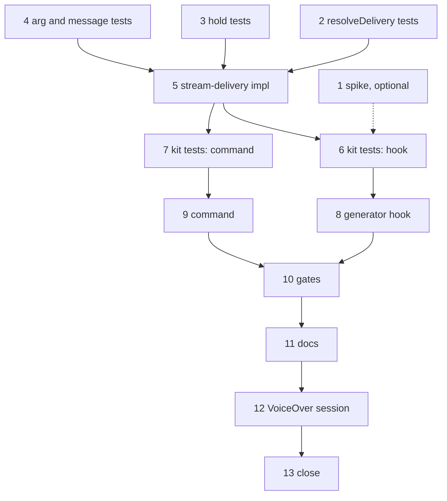

# Plan: Whole Answer Delivery

**Spec:** specs/whole-answer-delivery.md (v0.1.0)
**Created:** 2026-10-09
**Team:** solo
**Estimated Effort:** 10 h of focused work plus one manual VoiceOver session; three to four evenings
**Status:** In Progress (tasks 2 to 11 done on 2026-10-09; 1 optional, 12 and 13 need the VoiceOver session)

## 1. Overview

One new hook and one new command on top of the structure from the detection feature. The hook is an async generator on `turn.step` that, in buffered mode, drains the stream beneath into an array, drops `thinking` chunks, then yields the rest in order and rings the bell when the step had text. The decision whether to buffer is a pure function of the mode state (already computed at session start) and an override in `$.store`. The pure parts live in `hooks/lib/stream-delivery.ts` and are tested with Vitest; the generator and the command are wired in `hooks/register.ts` and tested with the `claude-code/testing` kit, whose bottom hook plays a scripted stream.

## 2. Task Breakdown

Estimates include a 20% contingency; the generator form of a hook is new ground in this repository.

### Phase 0: Spike (1 h, optional, needs an interactive session)

| # | Task | Spec Ref | Files | Type | Estimate |
|---|------|----------|-------|------|----------|
| 1 | Throwaway `turn.step` hook under `claude --plugin-dir .` that logs each chunk's `kind` and `index` to the debug log, to see the real sequence (text, tool, input, stop, engine) and whether thinking arrives before text | §9 verification | scratch, not committed | spike | 1 h |

The implementation does not wait for this: the chunk kinds are declared in the types. The spike only confirms ordering assumptions used in the tests.

### Phase 1: Pure module, test-first (3.5 h)

| # | Task | Spec Ref | Files | Type | Estimate |
|---|------|----------|-------|------|----------|
| 2 | Tests for `resolveDelivery`: mode on and no override → buffered (source mode); mode off → live; override buffered/live wins either way; malformed override ignored | AC-006, AC-007, TC-003, TC-004, TC-006 | tests/unit/stream-delivery.spec.ts | test | 0.5 h |
| 3 | Tests for the hold: `thinking` dropped; `text`, `tool`, `input`, `stop`, `engine` kept in order; `hasText` true only for a non-empty text chunk; empty text kept but not counted | AC-002, AC-003, AC-004, AC-005, edge cases | tests/unit/stream-delivery.spec.ts | test | 0.5 h |
| 4 | Tests for `parseStreamArg` (`""`, `on`, `off`, `auto`, garbage) and the reply lines of `/earshot-stream` in each state | AC-007, TC-004 | tests/unit/stream-delivery.spec.ts, tests/unit/consent.spec.ts (messages) | test | 0.5 h |
| 5 | Implement `hooks/lib/stream-delivery.ts`: `resolveDelivery`, `isStreamOverride`, `parseStreamArg`, `createHold()` returning `{ take(chunk), release() }` as plain data; add the reply lines to `hooks/lib/messages.ts` | AC-002 to AC-007 | hooks/lib/stream-delivery.ts, hooks/lib/messages.ts, hooks/lib/types.ts | impl | 2 h |

### Phase 2: Mod wiring, test-first (4 h)

| # | Task | Spec Ref | Files | Type | Estimate |
|---|------|----------|-------|------|----------|
| 6 | Kit tests: bottom `on('turn.step', async function* ...)` yields a scripted stream (thinking, text, text, tool, input, stop, engine) and counts its yields; in buffered mode the test receives the first chunk only after the bottom finished all yields, no thinking chunk, order preserved, one `ui.notify`; in live mode chunks arrive interleaved and thinking passes; `agentId` set → live; a tool-only step → no notify | AC-001 to AC-005, AC-008 | hooks/stream.test.ts | test | 1.5 h |
| 7 | Kit tests for `/earshot-stream` on, off, auto, report; override persisted in the mocked store | AC-007 | hooks/stream.test.ts | test | 0.5 h |
| 8 | Implement the generator hook in `hooks/register.ts`: read delivery mode from session facts, `for await` over `next(e)` into the hold, on `next.signal` abort yield what is held and return, then yield held chunks, `return stream.result`; `.catch` handler that forwards `next(e)` (check in the types whether the handler of a streaming hook is itself a generator) | AC-001, AC-009, AC-011 | hooks/register.ts | impl | 1.5 h |
| 9 | Register `earshot-stream` with `argumentHint: '[on|off|auto]'`, `command.run` handler, store writes; keep every helper top-level | AC-007, AC-012 | hooks/register.ts | impl | 0.5 h |

### Phase 3: Verification and docs (1.5 h + session)

| # | Task | Spec Ref | Files | Type | Estimate |
|---|------|----------|-------|------|----------|
| 10 | `npm test`, `claude plugin test .`, `tsc`, `eslint`, `claude plugin validate .`; confirm the validator lists `turn.step` and only the expected calls | AC-012 | | verify | 0.5 h |
| 11 | README section: whole answers, hidden thinking, the bell, `/earshot-stream`; CHANGELOG; CLAUDE.md layout line | AC-013 | README.md, CHANGELOG.md, CLAUDE.md | docs | 0.5 h |
| 12 | Manual VoiceOver session: TC-001 to TC-006; captures; note whether a long block is read as one unit | TC-* | tests/screenshots/whole-answer-delivery/, docs/testing/whole-answer-delivery.md | manual | 1 h |
| 13 | Fill "Maps to" in the spec, set its status, `/add:verify` | all | specs/whole-answer-delivery.md | verify | 0.5 h |

## 3. Execution Order

Critical path: 2/3/4 → 5 → 6 → 8 → 10 → 11 → 12 → 13.

## 4. TDD Strategy

### RED Phase (Tests First)
- Vitest suites (tasks 2 to 4) against the pure module's interface: chunks are literal objects of the declared kinds, no engine involved.
- Kit tests (tasks 6 and 7) script the stream from the bottom hook. The ordering assertion is the heart of the feature: a counter incremented by the bottom on every yield must equal the total when the test receives its first chunk in buffered mode, and must be smaller in live mode.

### GREEN Phase (Implementation)
- Task 5 first, then 8 and 9. The generator does the minimum: one loop, one array, one `yield` loop, one `notify`.
- Interruption (AC-009): wrap the `for await` in try/finally so held chunks are yielded on the way out whether the stream ended, threw, or the signal aborted.

### REFACTOR Phase
- If `hooks/register.ts` passes 300 lines, move the command handlers into `hooks/commands.ts` and keep `register.ts` to registration and the two hooks. Session facts stay in the one module-level record.

## 5. File Changes

### New Files
- `hooks/lib/stream-delivery.ts`: delivery resolution, override parsing, the hold
- `tests/unit/stream-delivery.spec.ts`
- `hooks/stream.test.ts`: kit tests for the hook and the command
- `docs/testing/whole-answer-delivery.md`: manual protocol (derived from the spec's TCs)
- `tests/screenshots/whole-answer-delivery/*.txt`: captures

### Modified Files
- `hooks/register.ts`: `turn.step` generator hook, `earshot-stream` command, facts extended with the delivery mode
- `hooks/lib/messages.ts`: reply lines for `/earshot-stream`
- `hooks/lib/types.ts`: `StreamOverride`, `DeliveryMode`
- `README.md`, `CHANGELOG.md`, `CLAUDE.md`
- `specs/whole-answer-delivery.md`: "Maps to", status

## 6. Dependencies

### Must Complete First
- Nothing in code: the detection feature already provides the mode state and the command pattern.
- A macOS machine with VoiceOver for task 12 (available).

### Can Parallelize
- Solo, so sequential. Tasks 2, 3 and 4 are independent and can be written in any order; tasks 6 and 7 likewise.

## 7. Risks and Mitigations

| Risk | Impact | Mitigation |
|------|--------|------------|
| The `.catch` handler of a streaming hook may need the generator form, and a thrown error mid-stream leaves already-yielded chunks in place | Medium: wrong handler shape fails validation or load | Read `Registration.catch` for `StreamHook` in the types before task 8; the kit test for the failure path catches a wrong shape |
| The engine may draw text as the hook yields it in a burst still line by line, and VoiceOver may still split a long block | Low: even split lines are read without interruption, which is the main gain | Task 12 records what is heard; if needed, add a trailing blank line to end the block cleanly |
| Holding chunks delays the engine's tool calls until the stream ends | None in practice: the engine runs tools only after the response is whole anyway | Documented in the spec's overview |
| Interruption while awaiting the stream beneath: the iteration may throw rather than end | Medium: a thrown error could skip the replay | try/finally around the loop (AC-009); kit test with an aborting signal if the kit allows it, otherwise manual TC-005 |
| Subagent steps buffered by mistake would hide their output from the main transcript | Low | AC-008 guard on `e.agentId`, kit test |
| The mode read at session start goes stale after `/earshot-on` | Low: the mode needs a restart anyway | Spec edge case; `/earshot-stream on` covers the session |

## 8. Acceptance Verification

| AC ID | Criterion | Test(s) | Status |
|-------|-----------|---------|--------|
| AC-001 | Drain, then replay in order, result unchanged | hooks/stream.test.ts ordering counter | Pending |
| AC-002 | tool, input, stop, engine always kept | stream-delivery.spec.ts hold; kit | Pending |
| AC-003 | thinking dropped | stream-delivery.spec.ts; kit | Pending |
| AC-004 | text byte-identical | kit: concatenated text equals scripted text | Pending |
| AC-005 | bell after a step with text, none without | kit: notify count | Pending |
| AC-006 | active in screen reader mode, live otherwise | stream-delivery.spec.ts resolveDelivery; kit live mode | Pending |
| AC-007 | /earshot-stream on, off, auto, report; stored | stream-delivery.spec.ts parse; kit command | Pending |
| AC-008 | subagent steps live | kit with agentId | Pending |
| AC-009 | interruption yields held chunks | try/finally; manual TC-005 (kit if the signal can be aborted) | Pending |
| AC-010 | no per-chunk work | review | Pending |
| AC-011 | .catch forwards unchanged | kit: hook made to throw via a poisoned chunk | Pending |
| AC-012 | validate lists turn.step and expected calls | task 10 | Pending |
| AC-013 | README | task 11 | Pending |

## 9. Plan History

- 2026-10-09: Initial plan from /add:plan. One generator hook plus one command on the existing structure; ordering counter in the kit test as the central assertion.
- 2026-10-09: TDD cycle 2 done in one sitting (about 1.5 h instead of 10 h: the structure from cycle 1 carried most of the work). Findings: the `.catch` handler of a streaming hook is a generator; the kit's `.result` promise settles undefined, so both the hook and the test read the iterator's return value; a test's bottom hook cannot fabricate engine chunks; a second hook on `store.set` needs a matcher beside `mock.store`. Two test rewrites recorded in .add/cycles/cycle-2/overrides.json.
